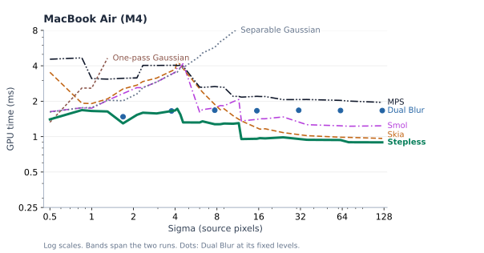
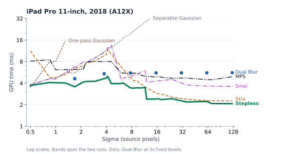
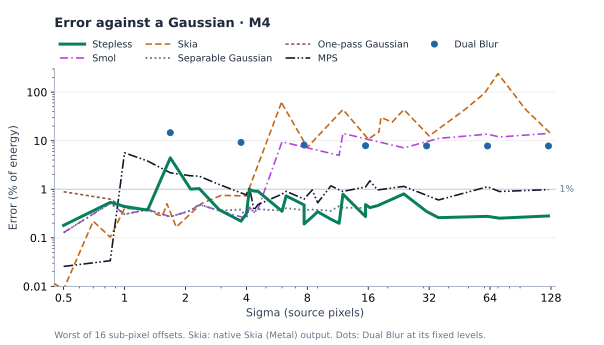
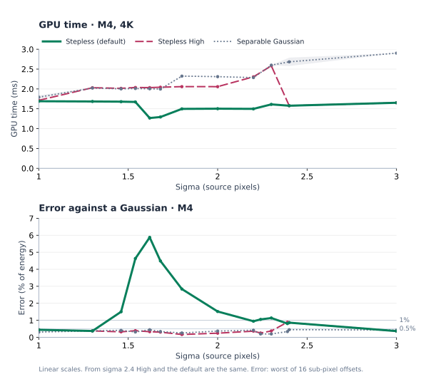

# Benchmarks

This page compares Stepless Gaussian Blur ("Stepless") with other blurs:
GPU time at 4K on seven GPUs, and accuracy and animated behavior on M4.
[Methods compared](#methods-compared) describes the other blurs.

| Device | GPU | API |
|---|---|---|
| MacBook Air | Apple M4 | Metal |
| iPhone 17 | Apple A19 | Metal |
| iPad Pro 11-inch, 2018 | Apple A12X | Metal |
| Galaxy S25 Ultra | Adreno 830 | Vulkan |
| Galaxy S26 | Xclipse 960 | Vulkan |
| Galaxy Tab S11 Ultra | Immortalis-G925 (Mali) | Vulkan |
| Galaxy A35 | Mali-G68 | Vulkan |

## Summary

Stepless is the fastest blur, or tied with the fastest, at most strengths
on every GPU tested. It costs about the same at every strength, and less
at wide ones, so animating sigma doesn't change the frame budget much.

Its weak spots sit just before it changes how it blurs, and the margins
there are small:

- Below sigma 1, a one-pass Gaussian is cheaper on most GPUs, by up to
  14%.
- Just below sigma 6.3, before its downsamples switch to a cheaper form,
  Smol catches up on Adreno and Mali-G68, and on Immortalis passes it.
- Just below sigma 11.5, where it hands over to a different layout, Skia
  catches up on four GPUs. On iPhone 17, Apple's built-in blur (MPS) is
  slightly faster there.

Two GPUs differ. On Immortalis, Stepless loses at sigma 1.7–2.9: most of
its time there goes to its first, full-resolution pass, and a separable
Gaussian, Smol and Skia are all faster. On both Mali GPUs (Immortalis and
Mali-G68), Smol or Skia is faster at wide strengths, by up to 13%.

Dual Blur costs about the same at each of its seven fixed strengths, so
it falls further behind as the blur widens, most on Apple GPUs. On Android
it beats Stepless only at its second strength. It cannot blur between
them.

Stepless stays close to a Gaussian except at sigma 1.4–2.3, where its
error reaches about 6%. If that range matters, [High
quality](#high-quality) fixes it at about the cost of a separable
Gaussian. Smol and Skia trade accuracy for speed from sigma 6, and Skia's
result depends on where a highlight falls.

Animated, Stepless changes as smoothly as an ideal Gaussian, and a moving
highlight keeps its place and brightness. Smol and Skia jump at their
internal level changes, and from sigma 8 both leave a moving highlight
behind; at wide strengths their output stops following it. Interpolated
Dual Blur, which blends two Dual Blur levels, pulses once per doubling of
sigma.

Where the result is sampled with bilinear filtering anyway, [reduced
output](#stepless-options) roughly halves the cost from sigma 4.

## GPU time

GPU time of each blur at 4K. Both axes are logarithmic, and every chart
spans the same number of doublings, so equal gaps mean equal ratios. Where two lines'
bands overlap, the chart does not say which is faster.

Stepless's time rises from sigma 0.5 to about 1. Below 0.75 it blurs in
one 2D pass; above, in separate X and Y passes at full resolution. From
1.6 it works at half resolution, and its time drops.

### MacBook Air (M4)

### iPhone 17 (A19)

### iPad Pro 11-inch, 2018 (A12X)

### Galaxy S25 Ultra (Adreno 830)

### Galaxy S26 (Xclipse 960)

The one-pass Gaussian's lead below sigma 1 is largest on this GPU.

### Galaxy Tab S11 Ultra (Immortalis-G925)

The weakest GPU for Stepless. For blurs that stay near sigma 2–3 on this
GPU, a separable Gaussian is the faster choice.

### Galaxy A35 (Mali-G68)

Smol stays ahead of Stepless from sigma 12, where Smol's error is 5–14%
and Stepless's under 1%.

## Quality

Error is the summed absolute difference between a blurred point and an
exact Gaussian, as a percentage of the point's energy. A single point is
the hardest case; smooth images differ less.

Stepless's error rises at sigma 1.4–2.3. There it blurs at half
resolution with a fitted pair of passes, which can't match the Gaussian's
shape exactly. Elsewhere its error stays around 1% or less; a separable
Gaussian measures 0.1–0.5% on this test. Smol and Skia trade accuracy for
speed from sigma 6.

### High quality

`BlurQuality.High` replaces the fitted pair with a full-resolution
separable Gaussian from about sigma 1.3 to 2.4, keeping the error under
0.5%. It costs about what a separable Gaussian costs, and nothing outside
that range.

## Stepless options

Reduced output (`RecordReduced`) returns a half-size or smaller texture
from sigma 3; it blends in over 2.75–3. The texture is not the finished
blur: sampling it with bilinear filtering is the last step. Its error is
at most 1.3%, and it pays off from sigma 4.

High costs the most on Apple GPUs and nothing extra on Immortalis, where a
separable Gaussian is already faster than the default. Time of each,
divided by the default's:

| Device | High, sigma 1.3–2.3 | Reduced, from sigma 4 |
|---|---|---|
| MacBook Air (M4) | 1.25–1.59 | 0.45–0.56 |
| iPhone 17 | 1.26–1.76 | 0.44–0.57 |
| iPad Pro (A12X) | 1.40–1.80 | 0.47–0.63 |
| Galaxy S25 Ultra | 0.98–1.27 | 0.46–0.58 |
| Galaxy S26 | 1.00–1.48 | 0.39–0.48 |
| Galaxy Tab S11 Ultra | 0.88–1.01 | 0.46–0.61 |
| Galaxy A35 | 1.00–1.25 | 0.36–0.45 |

## Animation

The chart blurs one stationary point while sigma grows from 0.3 to 128
in 0.6% steps, and plots how much the output changed per step, relative
to an ideal Gaussian's change. A line at 1 grows like an ideal Gaussian.
Below sigma 0.3 a blur barely changes any pixel, so the ratio is noise for
every blur.

Stepless stays near 1, so an animated Stepless blur grows evenly. Below
sigma 1 it wobbles more, because texture reads snap to 1/256 of a pixel
and a small blur has few of them. Where it changes its internal passes,
the output barely jumps.

Interpolated Dual Blur speeds up and slows down once per doubling of
sigma, so an animated blur pulses. Smol jumps once per doubling, where it
changes its working resolution, and grows evenly in between. Skia jumps
at each internal level change and drifts between them.

A bright point moves 1/16 px per frame under a fixed blur. Even an ideal
blur's brightness varies a little as the point crosses pixels; the lower
chart shows variation beyond that.

Stepless keeps the blur centered on the point and its brightness steady,
except near sigma 1.6, the same range where its error rises. Smol and
Skia work on a coarse grid, so from sigma 8 their blur falls behind the
point. From sigma 24 Smol's output, and from 48 Skia's, is the same in
every frame: the blur stays put while the point moves away. Skia also
flickers at 18–24. Interpolated Dual Blur flickers most at small
sigma, below its first level.

These charts show how the blurs differ on a single point. They do not say
whether a difference is visible.

## Methods compared

- Separable Gaussian: a horizontal and a vertical pass, reading two
  taps per bilinear fetch, measured up to sigma 16. The kernel ends at 4 sigma.
- One-pass Gaussian: one 2D pass, up to sigma 1.54; the last measured
  point is 1.3. The kernel
  ends at 4 sigma.
- Dual Blur: the [published kernels][dual] at their fixed levels 1–7,
  each plotted at the sigma of the Gaussian with the same variance. It is
  designed for cheap fixed blurs, not to match a Gaussian, so its error
  here is how far it is from one.
- Interpolated Dual Blur: written for this comparison. It blends two
  adjacent Dual Blur levels to reach any strength. Animation charts only.
- Skia: the blur in Google's 2D graphics library. It downsamples
  bilinearly, runs a small Gaussian and upsamples bilinearly, so its cost
  is bounded at any sigma. Timing and animation use a Unity port; quality
  uses native Skia output
  ([revision 15a9437][skia]). The port matches native Skia within 0.84%
  of input energy at every tested sigma and position.
- Smol: Aras Pranckevičius's [blur for animated radii][smol], a Unity
  port of [revision 773d5f7][smol-source]. It downsamples by averaging,
  runs a Gaussian at the reduced size and upsamples once.
- MPS: Apple's built-in `MPSImageGaussianBlur` (Metal Performance
  Shaders) with clamped edges, timed the same way as the others.

For timing, every blur except MPS is a Unity implementation in one
harness.

## How it was measured

### Timing

Unity 6000.6.2f1 Players blur a 3840×2160 RGBA16F crop of
[Wide Street 01][scene] (CC0), an HDR street photograph with a peak value
of 50.

- A run is one batch of timed blurs at one sigma. Each blur and sigma gets
  two runs, in two separate sweeps over all sigmas. One Android point has
  one.
- A chart point is the mean of the two runs' medians. The band spans the
  two.
- Every run starts and ends with the device not thermally throttled.
- Two blurs within about 3% of each other are called tied.
- Times include one copy of the result into an export texture, the same
  cost for every blur, so ratios slightly understate differences.
- Where two blurs' bands overlap, the chart does not say which is faster.

Apple devices run Metal Release Players with the GPU in its maximum
performance state. A run times 40 blurs. Each command buffer finishes
before the next starts, so these are isolated blur times; the saving in a
real frame may be smaller.

Android devices run Vulkan Development Players, which expose Unity's GPU
Recorder, on Samsung Remote Test Lab, where GPU clocks cannot be fixed.
Each frame repeats the blur until it holds 12 ms of GPU work, so the
clocks stay up.

- Two fixed reference draws run every frame as clock probes.
- A frame counts only when both are within 10% of their fastest time in
  the session.
- On Xclipse and Mali-G68 only the first probe counts, because the second
  one's time depends on the blur drawn before it.

Drivers: Adreno 512.800.35 (Android 15), Xclipse 25.2.39 (Android 16),
Immortalis r49 (Android 16), Mali-G68 r38 (Android 15).

How much the two runs of a point differed:

| Device | Median | Largest |
|---|---|---|
| MacBook Air (M4) | 0.41% | 5.4% |
| iPhone 17 | 0.52% | 31.5% (reduced output, sigma 24) |
| iPad Pro (A12X) | 0.41% | 3.2% |
| Galaxy S25 Ultra | 0.27% | 4.4% |
| Galaxy S26 | 0.44% | 12.5% |
| Galaxy Tab S11 Ultra | 0.59% | 12.5% |
| Galaxy A35 | 0.39% | 16.1% |

### Quality

The test image is 1536×1536 linear RGBA16F with one HDR point. The test
runs 16 times, with the point at different sub-pixel offsets. Each result is compared with a Gaussian truncated at ±6 sigma
and normalized. Error is the summed absolute difference as a percentage
of input energy, at the worst offset. A single point is the hardest case
for blurs that reduce resolution first; smooth images differ less.

### Animation

Editor batch mode, Metal on M4. The sigma sweep blurs one point at 2,284
sigmas: 1,024 log-spaced from 0.25 to 128, plus dense samples where
Stepless changes its internal passes. The motion test moves the point
1/16 px per frame along the diagonal for 64 frames, at 9 sigmas.

## Data

- Timing: [M4](Benchmarks/timing-m4.csv) · [iPhone 17](Benchmarks/timing-iphone17.csv) · [iPad Pro](Benchmarks/timing-ipadpro-a12x.csv) · [Galaxy S25 Ultra](Benchmarks/timing-s25.csv) · [Galaxy S26](Benchmarks/timing-s26.csv) · [Galaxy Tab S11 Ultra](Benchmarks/timing-tabs11.csv) · [Galaxy A35](Benchmarks/timing-a35.csv) · [High quality](Benchmarks/high-quality-m4.csv)
- Quality: [all blurs](Benchmarks/quality-m4.csv) · [Dual Blur](Benchmarks/fixed-dual-quality-m4.csv) · [error split into shape, position and energy](Benchmarks/quality-split-m4.csv)
- Dual Blur timing, separate runs: [M4](Benchmarks/fixed-dual-timing-m4.csv) · [iPhone 17](Benchmarks/fixed-dual-timing-iphone17.csv) · [iPad Pro](Benchmarks/fixed-dual-timing-ipadpro-a12x.csv)
- Skia: [native validation](Benchmarks/native-skia-validation.json) · [per position](Benchmarks/native-skia-phases.csv)
- Animation: [sigma sweep](Benchmarks/continuity-m4.csv) · [switches](Benchmarks/continuity-switches-m4.csv) · [motion](Benchmarks/motion-m4.csv)

[dual]: https://community.arm.com/cfs-file/__key/communityserver-blogs-components-weblogfiles/00-00-00-20-66/siggraph2015_2D00_mmg_2D00_marius_2D00_notes.pdf
[skia]: https://github.com/google/skia/tree/15a9437eec871d9a90a91514e368c5a6cb29bb4b
[scene]: https://polyhaven.com/a/wide_street_01
[smol]: https://aras-p.info/blog/2026/10/01/Fast-blur-with-animated-radius/
[smol-source]: https://github.com/aras-p/blur-playground/blob/773d5f78ff50cde7c809ed900ad30ccd8e7afba7/js/smol-gaussian.js
