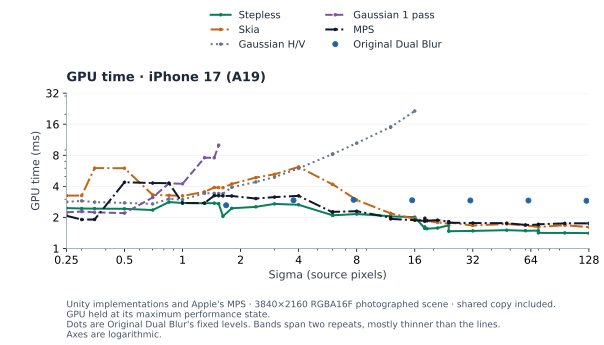
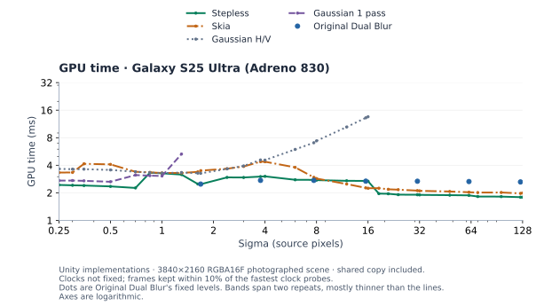
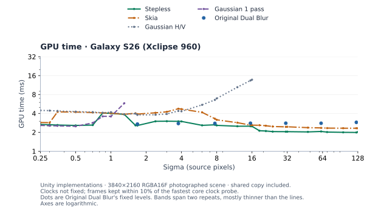
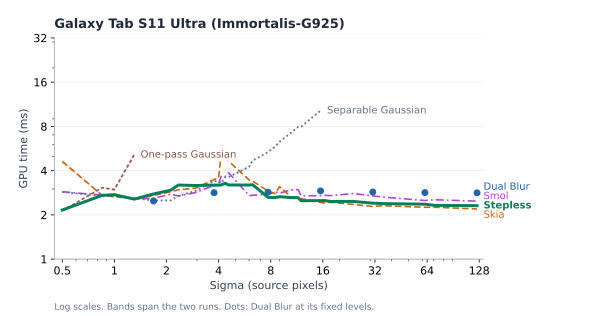
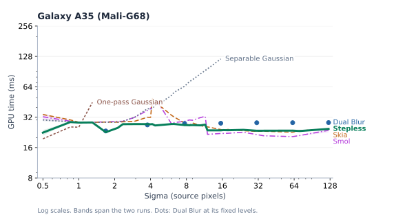
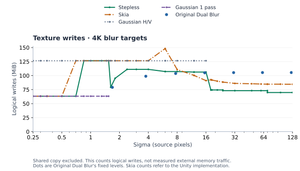
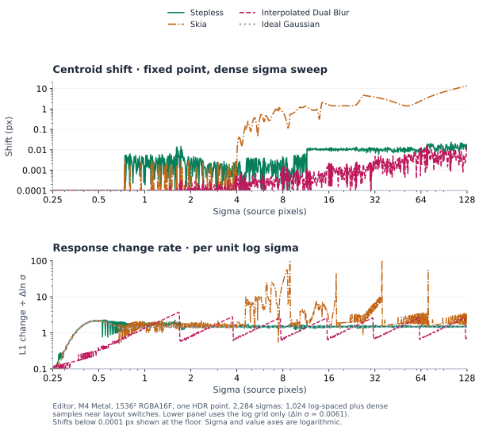
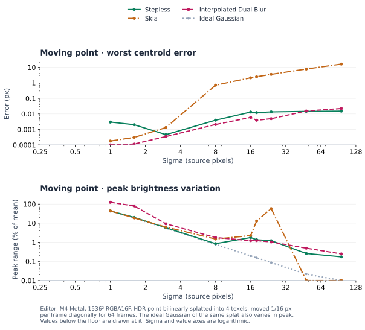

# Benchmarks

## Methods compared

- Gaussian H/V
  - A separable kernel with bilinear pairs, up to sigma 16.
  - Tapers at four sigma.
- Gaussian 1 pass
  - A 2D kernel, up to sigma 1.54.
  - Tapers at four sigma.
- Original Dual Blur
  - The [published kernels][dual] at depths 1–7, plotted at the sigma of
    the Gaussian with the same variance.
  - It is designed for cheap fixed-level blurs, not to match a Gaussian;
    its error is its difference from that Gaussian.
- Interpolated Dual Blur
  - A variant written for this comparison that blends adjacent depths to
    reach any strength.
  - It appears in the continuity and motion charts.
- Skia
  - Bilinear reductions, a small Gaussian and bilinear upsampling, for
    bounded cost at any sigma.
  - Timing uses a Unity port; quality uses native Skia Ganesh/Metal output
    ([revision 15a9437][skia]).
  - The port matches all 560 native point responses within 0.84% of input
    energy.
- MPS
  - Apple's `MPSImageGaussianBlur` with clamped edges, in the same command
    buffer as the others.
  - Its passes are not public, so its texture writes count the output
    only.

Every method except MPS is a Unity implementation in one harness. Timing
blurs a photographed scene at 4K; quality and motion use a single HDR
point. [Methods](#methods) has the details.

## Summary

Stepless's strong and weak ranges are much the same on every GPU tested.

- Below sigma 0.75 it runs one 2D pass, like a one-pass Gaussian, and the
  two cost about the same. On iPhone, MPS is 16–22% faster up to 0.35.
- Its two weak ranges sit next to layout switches.
  - At sigma 0.85–1, just after it moves to separate X and Y passes, a
    one-pass Gaussian is 7–11% faster on Adreno, Xclipse and Mali-G68.
  - At sigma 12–16, its pyramid's deepest levels, Skia or MPS is up to
    25% faster on every GPU except Xclipse.
- Between those ranges it leads or ties, with exceptions on the Android
  GPUs.
  - On Immortalis, a separable Gaussian is 8–16% faster at sigma
    1.62–3, and Original Dual Blur's depths 1–4 are 8–11% faster.
  - On Adreno, Xclipse and Mali-G68, Original Dual Blur's depth 2
    (sigma 3.76) is 2–9% faster.
- From sigma 18 it leads by 4–24% on Apple, Adreno and Xclipse. On the
  two Mali GPUs, Skia matches it within 6%.
- Original Dual Blur costs about the same at every depth, so it falls
  further behind as the blur widens. At depths 5–7 it takes 1.2–2 times
  Stepless's time, the most on Apple GPUs.

In quality and motion, Stepless is weakest around sigma 1.6 and close to
a Gaussian elsewhere.

- Its error stays near 1% except at sigma 1.4–2.3, where it reaches 6.2%.
  There, a moving highlight's peak also varies by up to 6.7%.
- Skia's coarse reductions make its output depend on where a highlight
  falls. From sigma 6 its error ranges from 7% to 241%, a highlight can
  move by 22 px or vanish, and at sigma 48 and 96 the output stays put
  while the point moves 4 px.
- As sigma changes, Stepless's largest measured step equals an ideal
  Gaussian's change over 0.5% of strength, at sigma 0.74. Interpolated
  Dual Blur, which also takes any strength, varies by 245% in motion below
  its first level.

## MacBook Air (M4)

## Other devices

### iPhone 17 (A19)

### Galaxy S25 Ultra (Adreno 830)

### Galaxy S26 (Xclipse 960)

### Galaxy Tab S11 Ultra (Immortalis-G925)

### Galaxy A35 (Mali-G68 MP5)

## Texture writes

Bytes written to blur targets, including the result. This is not memory
traffic: reads, caches and framebuffer compression are excluded.

## Continuity and motion

Animating strength, measured on one point:

- From sigma 4, Stepless's output changes at 0.92–1.09 times an ideal
  Gaussian's pace (5th–95th percentile over 0.6% sigma steps), so an
  animated blur grows evenly. At 1–4 the range is 0.95–1.29.
- Below sigma 1, fetch positions step along the sampler's 1/256 grid, and
  the pace varies from 0.6 to 1.5 times the ideal's.
- Grid steps are its largest jumps. With few fetches, one moving 1/256 texel
  shifts much of the weight: at sigma 0.74 a single step equals an ideal
  Gaussian's change over 0.5% of strength, and near 1.1 and 1.6 over
  0.2%. Layout switches are smaller; the largest, at 16.1, equals 0.13%.
- Interpolated Dual Blur's pace swings between 0.5 and 1.7 times the
  ideal's within each level, so it speeds up and slows down every
  octave. Below sigma 1 it is 0.1–0.9 times, barely changing.
- Skia moves at 3.6 times the ideal's pace at the median at sigma 4–16,
  and up to 286 times at its level changes; from 16, 1.3 times, up to 76.
  A fixed point's center drifts by up to 13.5 px as strength changes.

A point moving 1/16 px per frame at fixed strength. Even an ideal
Gaussian's peak varies as the point crosses pixels, so flicker below is
measured against the ideal's:

- Stepless tracks the point within 0.015 px and keeps its energy within
  0.18%.
- Its peak stays within 0.6% of the ideal's except at sigma 1.6 (6.7%),
  its weakest range, and at 18–24 (1.2%), where its Gaussian runs on a
  reduced grid.
- Interpolated Dual Blur's peak strays from the ideal's by 245% at sigma
  1 and 103% at 1.6, below its first level.
- Skia lags the point by 0.7 px at sigma 8 and 16 px at 96. At 18–24 a
  highlight's brightness pulses by 13–58%. At 48 and 96 its output does
  not move at all over the 4 px path.

## Methods

### Timing

Unity 6000.6.2f1 Players. The input is a 3840×2160 RGBA16F crop of
[Wide Street 01][scene] (CC0): an HDR photograph of buildings, trees,
parked cars, sky and road, peaking at 50.

- Timings include one shared copy of each result into an export texture.
  It adds the same time to every method, so ratios between methods
  understate their difference.
- Each block starts only once the device reports its nominal thermal
  state.
- Where repeat bands overlap, the order of two methods is not resolved.

M4 MacBook Air and iPhone 17: Metal Release Players with the GPU in its
maximum performance state.

- Each point averages two block medians of 40 GPU timestamps; the band
  spans the two.
- Each command buffer finishes before the next starts, so these are
  isolated blur timings, not frame-time savings.
- Repeats differed by 0.43% at the median and 8% at most on the Mac, and
  0.59% and 11.1% on the phone (Stepless at sigma 62). Six of 652 blocks
  ended above nominal; their repeats agree within 7.9%.

Galaxy S25 Ultra (Adreno 830, Android 15, driver 512.800.35), Galaxy S26
(Xclipse 960, Android 16, driver 25.2.39), Galaxy Tab S11 Ultra
(Immortalis-G925, Android 16, driver r49) and Galaxy A35 (Mali-G68,
Android 15, driver r38) on Samsung Remote Test Lab.
Vulkan Development Players on remote devices whose clocks cannot be fixed.

- Each frame repeats the blur until it holds 12 ms of GPU work, so the
  clocks stay up; times are per blur, measured with Unity's GPU Recorder.
- Two clock probes run in every frame. Frames count only when both are
  within 10% of the session's fastest. On Xclipse, the copy probe's time
  follows the method drawn before it, so only the core probe counts.
- Each point averages two block medians. Repeats differed by 0.30% at the
  median and 2.8% at most on the S25 Ultra,
  0.23% and 1.6% on the S26, 0.67% and 6.6% on the Tab S11 Ultra, and
  0.28% and 1.6% on the A35.

### Quality

1536×1536 linear RGBA16F, an HDR point at 16 interior positions, compared
with a discrete Gaussian truncated at ±6σ and normalized. Error is the
summed absolute difference as a percentage of input energy, at the worst
position, without recentering. Shape error recenters and renormalizes the
reference first. A single point is the hardest case for methods that
reduce resolution first; smooth images differ less.

### Continuity

Editor batch mode, Metal on M4. One point at 2,239 sigmas: 1,024
log-spaced from 0.25 to 128 plus dense samples around each switch. Change
is the L1 difference between neighboring responses. Motion moves a
bilinear splat 4 px diagonally over 64 frames at 9 sigmas.

These numbers are for points. They are not visibility thresholds.

## Data

- [M4 timing](Benchmarks/timing-m4.csv) · [iPhone timing](Benchmarks/timing-iphone17.csv) · [Galaxy S25 Ultra timing](Benchmarks/timing-s25.csv) · [Galaxy S26 timing](Benchmarks/timing-s26.csv) · [Galaxy Tab S11 Ultra timing](Benchmarks/timing-tabs11.csv) · [Galaxy A35 timing](Benchmarks/timing-a35.csv) · [Quality](Benchmarks/quality-m4.csv)
- Original Dual Blur: timing ([M4](Benchmarks/fixed-dual-timing-m4.csv), [iPhone](Benchmarks/fixed-dual-timing-iphone17.csv)) · [quality](Benchmarks/fixed-dual-quality-m4.csv)
- Skia: [native validation](Benchmarks/native-skia-validation.json) · [per position](Benchmarks/native-skia-phases.csv)
- Continuity: [sweep](Benchmarks/continuity-m4.csv) · [switches](Benchmarks/continuity-switches-m4.csv) · [motion](Benchmarks/motion-m4.csv) · [error split](Benchmarks/quality-split-m4.csv)

[dual]: https://community.arm.com/cfs-file/__key/communityserver-blogs-components-weblogfiles/00-00-00-20-66/siggraph2015_2D00_mmg_2D00_marius_2D00_notes.pdf
[skia]: https://github.com/google/skia/tree/15a9437eec871d9a90a91514e368c5a6cb29bb4b
[scene]: https://polyhaven.com/a/wide_street_01
