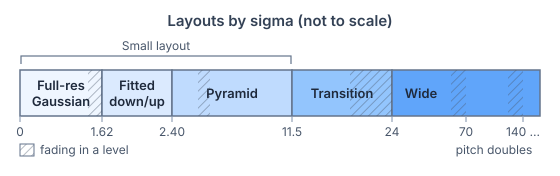
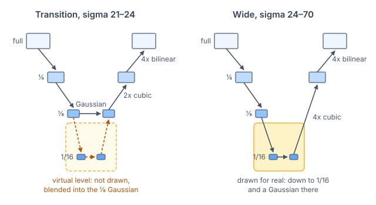
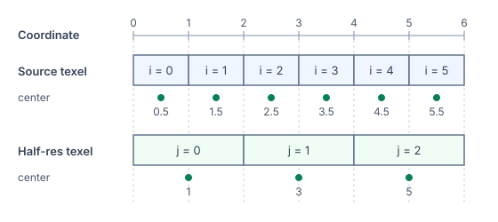
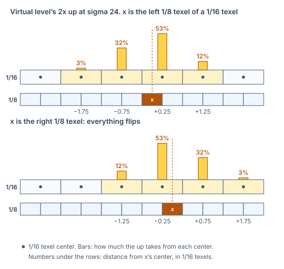

# Design

The blur runs one of three layouts, picked by sigma. A layout is a chain
of render passes. As sigma grows, the passes' weights change, and at some
sigmas the chain gains passes.

- Small, below sigma 11.5. As sigma grows it takes three forms: a
  full-resolution Gaussian, a fitted down/up pair, and a pyramid.
- Transition, from 11.5 to 24.
- Wide, from 24.



## Terms

- 1/N: a texture at 1/N of the source resolution.
- Target: the blur asked for, a Gaussian of the requested sigma whose
  weights taper smoothly to zero at four sigma.
- The Gaussian: a chain's Gaussian pass, or its X and Y passes, at the
  chain's coarsest resolution.
- Level: a 2x down, the rest of the blur at half resolution, then a 2x up
  to the starting resolution. Levels nest; the innermost runs the
  Gaussian.
- Fading in: before a chain gains passes, its Gaussian gradually takes on
  their effect, so an animated blur doesn't jump. The hatched ranges in
  the figure above are fades.

## Variance budget

Every pass blurs, including the downs and ups. When passes run in
sequence, their variances (sigma²) add. So the Gaussian gets whatever the
downs and ups leave of the target's variance. The wide layout at sigma 24,
along one axis, in source pixels²:

| Passes | Variance |
|---|---|
| Downs | 62.76 |
| Gaussian | 423.46 |
| Ups | 88.15 |
| Total, the target | 574.37 |

The total is under 24² = 576 because of the target's taper.

Every layout hits the target variance to within 2 parts per million,
ignoring GPU rounding. The shape is close but not exact. A single bright
pixel's blur differs from the target by up to 6.2% of its brightness,
summing absolute differences, worst at sigma 1.4–2.3
([benchmarks](Benchmarks.md#summary)).

## Full-resolution Gaussian (below sigma 1.62)


- In the small layout, a Gaussian that needs at most three bilinear
  fetches per axis runs as one 2D pass. From four it runs as separate X
  and Y passes, which measured 23% faster on M4.
- While fading in a pyramid level, the Gaussian is always X then Y.
- X and Y rows of up to 5, 8, 10 or 12 fetches run unrolled passes;
  longer rows loop. Late in a level's fade, rows take 10. Looped, those rows took
  up to 1.3 times as long on M4 and iPhone 17.
- In the full-resolution Gaussian, the switch to X then Y is at sigma
  0.75.
- From 1.46 to 1.62 the Gaussian fades in the fitted down/up pair.
- With `BlurQuality.High` the Gaussian runs to 2.40 with its full taper
  and never uses the fitted pair. From 2.24 to 2.40 it fades in the first
  pyramid level.

## Fitted down/up pair (sigma 1.62–2.40)

A plain 2x down then 2x up blurs by one fixed amount, about sigma 1.6. To
cover 1.62–2.40, the pair's weights are functions of sigma, fitted
offline. From 1.72 a Gaussian at 1/2 runs between them, growing from zero
width.


The fit asks the pair to:

- blur a single bright pixel like the target, at an even or an odd
  position;
- change smoothly as the pixel moves or sigma changes;
- keep weights nonnegative, summing to one and centered;
- equal the pyramid's down and up at 2.40.

Rounding the up's fetch positions ([Bilinear fetches](#bilinear-fetches))
and interpolating the fit's lookup table leave the pair's variance
slightly off. Below 1.72 the down's outer weights correct it. Over
1.72–1.80 the Gaussian at 1/2 takes over that correction.
[`Tools~/FilterFit`](../Tools~/FilterFit/README.md) reruns the fit.

## Pyramid (sigma 2.40–11.5)


- Each level is a 2x down and a 2x cubic B-spline up, except the
  outermost up below.
- The down is the 6-tap binomial below 5.9 (nine fetches) and
  [1, 3, 3, 1] / 8 from 6.3 (four fetches). Over 5.9–6.3 one turns into
  the other.
- A second level fades in over sigma 3.94–4.22 (3.86–4.15 in a reduced
  output). There is no third: the quarter-res Gaussian reaches 12
  fetches by 11.5.
- From 4.25 to 4.5 the outermost up blends from cubic to bilinear: one
  fetch per pixel instead of four.

## Transition layout (sigma 11.5–24)


Like a third pyramid level, the transition runs the Gaussian at 1/8 and a
2x cubic up to 1/4. From the wide layout, it takes the outer passes:

- One 4x down replaces two 2x downs.
- One 4x bilinear up replaces two 2x ups.

It takes over from the pyramid at 11.5. From there its error stays
under 1%.

Its passes stay fixed up to 24; only weights change:

- 16.1–16.6: the 2x down to 1/8 blends into the wide layout's 4-tap down.
- 16.1–16.6: the Gaussian pass's own taper widens from four of its sigmas
  to five, as in the wide layout. This taper is separate from the
  target's. With four, the X and Y passes clip the blur's faint outer edge
  into a visible square.
- 21–24: the Gaussian fades in a level at 1/16, where the wide layout runs
  its Gaussian.

## Wide layout (sigma 24 and above)


- The pitch is how many source pixels wide one texel of the Gaussian's
  texture is. It is 16 in the figure.
- The pitch doubles at sigma 70, 140, 280, …. Each doubling adds a 4-tap
  2x down, which keeps the Gaussian under 32 fetches per axis.
- The cubic up is always 4x, so the bilinear up scales by the rest,
  pitch/4.
- Each doubling fades in from 7/8 of its sigma (61.25–70, …), as 21–24
  does.

## Fading in a level



A level is linear and separable. Along each axis its effect on the
Gaussian's texels is a weighted sum of their neighbors, the same form as
the Gaussian's X and Y passes. The figure shows the fade at 21–24, where
the Gaussian runs at 1/8. The CPU computes the level's weight array,
called the virtual level. Nothing extra is drawn. Over the fade, the CPU
mixes it into the Gaussian's weights:

```
weight[i] = (1 − s) · gaussian[i] + s · virtual[i]
s         = smoothstep(21², 24², sigma²)
```

Each array alone gives the target's variance, so any mix does too. At 24
the weights are the virtual level alone, and the wide layout then draws
that level for real.

### What the fade can't hide

Inside the small layout, a fade ends on exactly the level drawn next. At
11.5, 24 and each doubling, the downs and ups change too. A virtual level
can't reproduce that:

- 11.5 switches passes without a fade.
- At 24, the virtual level's 2x up and the 2x cubic up give way to one 4x
  cubic up.
- At each doubling, the virtual level's 2x up and the 4x cubic up give way
  to one 4x cubic up from one level coarser, and the bilinear up grows 2x.

Neither the transition nor the wide layout draws the virtual level's 2x
up, so its weights are free to tune. `Tools~/FilterFit/fit_transition.py`
places that up's fetches so the blur matches across 24 and each doubling.
Doublings past sigma 560 reuse 560's fit. The largest remaining jump is at
11.5. It is about as large as changing sigma by 0.23%
([benchmarks](Benchmarks.md#continuity-and-motion)).

## Reduced output

`RecordReduced` skips the last bilinear up and returns a texture at 1/R
resolution. The caller does the skipped upscale by sampling it bilinearly.
R is the skipped up's scale factor: 2 in the pyramid from sigma 3, 4 in
the transition, pitch/4 (at most 128) in the wide layout. A reduced
output's outermost up blends from cubic to bilinear over 2.75–3, instead
of `Record`'s 4.25–4.5, so R is 1 below 3.

R is halved until it divides both image sides. When the cap or halving
lowers R, the layout still runs the reduced output's bilinear up, to 1/R.
The variance budget counts the sampler's upscale in place of the skipped
pass.

## Conventions



- Shaders measure positions in texels of the texture being read, from its
  left edge, as in `SV_Position`: texel `i`'s center is at `i + 0.5`. The
  CPU weight builders put texel centers at integers; offsets are the same
  either way.
- A downsampled texel is centered on the source texels it covers.
- A weight's offset is the distance from the pass's anchor to the position
  it reads. The anchor is the output texel's center, except that ups
  measure from the coarse texel's center, and the quarter and the
  transition's halve from the first source texel they cover.

### Up weights mirror between phases

After a 2x down, each coarse texel covers two fine texels, one left of its
center and one right. An output texel's phase says which of the two it is.
The two phases see the coarse centers at mirrored distances, so their up
weights are mirror images.



- An up stores one weight array per phase: two for a 2x up, four for the
  4x cubic up.
- Like an up, a Gaussian with a virtual level mixed in needs a left and a
  right array, because the virtual level contains a 2x up.
- The transition and wide layouts store only the left array. The shader
  mirrors it for the right phase, so every pixel reads the same constant
  addresses.

### Halo

- Every intermediate texture below full resolution has a border of three
  extra texels on each side, four on the transition Gaussian's axes. A
  reduced output has none.
- These texels hold the blur of the source with its edge pixels repeated
  outward. Clamping at a texture's edge would blur pixels near it
  differently from a full-resolution blur, so passes read into the halo
  instead.
- A pass that reads past the halo, as a long Gaussian does, clamps to the
  halo's outermost texel.

### Bilinear fetches

- The GPU sampler rounds each fetch position to a 1/256-texel step.
  Builders round each fetch to a step, then adjust the weights. Gaussian
  arrays keep their sum, center and variance; up arrays keep their sum and
  center.
- The downs and cubic ups that don't change with sigma are rounded once,
  when their constants are built, with their weights solved to match.
- The shader nudges each fetch by 1/1024 texel so float rounding can't
  push it into the wrong step. Above 4096 texels per axis a fetch can
  still land one step off. That moves under 0.4% of its weight to the
  neighboring texel.

## Vocabulary

Names used in the code:

| Term | Meaning |
|---|---|
| Grid 1/N | A texture at 1/N resolution |
| Down | The small layout's 2x down; DownHalve once it is [1, 3, 3, 1] / 8 |
| Up | The small layout's and the transition's 2x up, fitted or cubic |
| LinearUp | The pyramid's outermost up, once fully bilinear |
| Quarter | The 4x down |
| Halve | The transition's and the wide layout's 2x down |
| Cubic | The wide layout's 4x cubic up pass |
| Final | The transition and wide layouts' bilinear up, to full resolution or to 1/R |
| Origin | The texel where a texture's image starts, past its halo |
| Pair | Two neighboring texels read by one bilinear fetch, not the fitted pair |
| Crossfade | Fading in a level or the fitted pair |
| Keyword set | A material's shader keywords: float or half precision for 2D Gaussian samples, and whether each pass rounds its output to packed-float (B10G11R11) values |

## Changing the shaders

Any change to the compiled shader needs a timing A/B on an M4 Mac, an
iPhone and an Android phone. Uniform names, declaration order and array
sizes change the compiled shader; comments, function names and moving code
between includes don't.

`Small.hlsl` samples through `SampleSource`, a variant of `SampleClamped`
from `Common.hlsl` that adds the halo offset itself. Routing through the
shared one measured up to 9% slower on Adreno 830.
