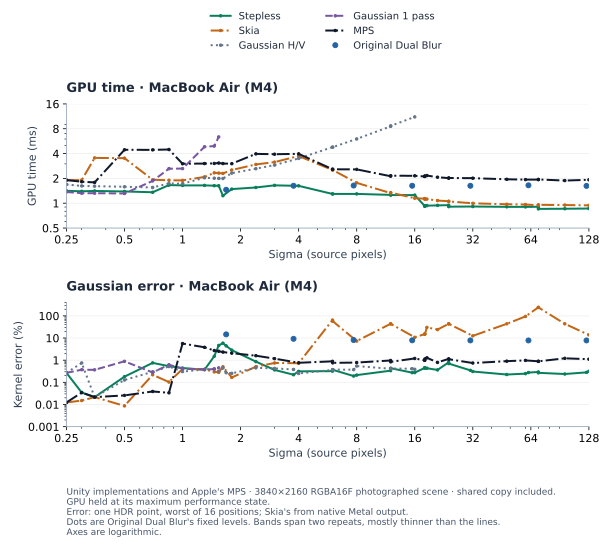
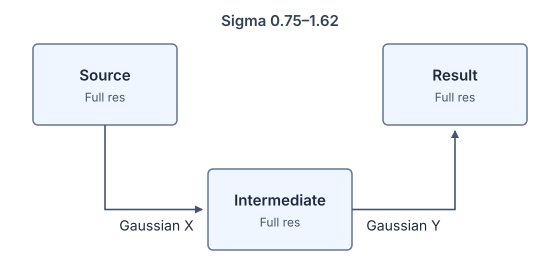
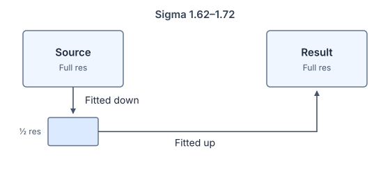
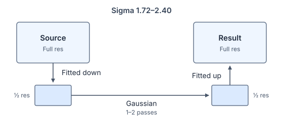
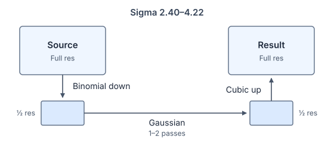
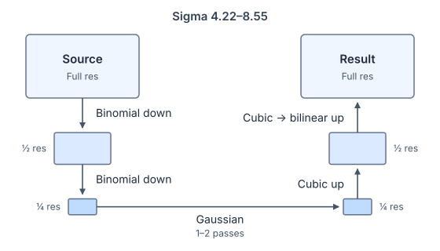
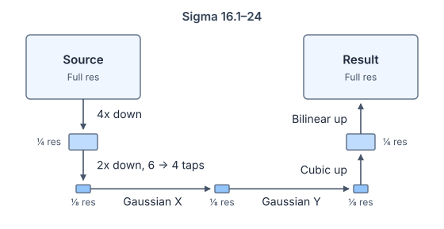
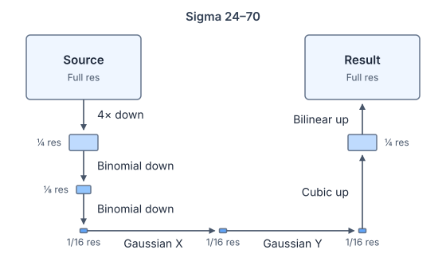

# Stepless Gaussian Blur

A Gaussian blur for URP RenderGraph that stays fast, accurate and stable
at every strength.

https://github.com/user-attachments/assets/800f74d7-72c0-4280-a5a2-b39e1d6fa7ef

Use it as a camera effect, inside your own RenderGraph passes, or to blur
a texture once and reuse it.

## Goals

Most blurs are fast or accurate in one range of strengths and compromise
in the rest. Stepless aims to hold up across the whole range:

- Fast at small strengths, where a pyramid can't reduce resolution yet.
- Even cost across strengths.
- Any sigma, so strength can be animated smoothly instead of stepping
  between pyramid levels.
- Stable in motion: a moving highlight follows its true position instead
  of jumping with a coarse grid.
- Close to a true Gaussian.
- Fragment shaders only. Compute relies on shared memory, which some
  mobile GPUs don't keep on chip.
- One implementation for every GPU, with no per-vendor paths.

## Benchmarks



On M4 at 4K, blurring a photographed scene:

- Stepless's cost stays in a narrow band, highest up to sigma 4.2 and
  falling as the blur widens. Skia and MPS jump in cost where they switch
  internal levels.
- At wide strengths, Stepless takes about half the time of Dual Blur,
  and it also reaches the strengths between Dual Blur's levels.
- Smol, another variance-compensated pyramid, takes 1.3–1.5 times as
  long from sigma 16, with 5–14% error from sigma 6.
- Stepless stays close to a Gaussian except at sigma 1.4–2.3, where its
  error peaks at about 6% near 1.6.
  Skia's error grows large at wide strengths and depends on where a
  highlight falls on its coarse grid.

[Benchmark details](Documentation~/Benchmarks.md) cover the iPhone,
iPad, Adreno, Xclipse, Immortalis and Mali GPUs, animation and methods.

## Installation

Requires Unity 6000.3 or later and URP 17.3 with RenderGraph
(Compatibility Mode off).

In the Package Manager, choose **Install package from git URL**:

```
https://github.com/aki-null/SteplessGaussianBlur.git
```

Or add it to `Packages/manifest.json`:

```json
"net.aki-null.stepless-gaussian-blur": "https://github.com/aki-null/SteplessGaussianBlur.git"
```

Append `#<tag>` to pin a release.

The package adds its shader to `UniversalRenderPipelineGlobalSettings.asset`.
After removing the package, that entry stays with a missing type. Clear it
from an editor script:

```csharp
var settings = GraphicsSettings.GetSettingsForRenderPipeline<UniversalRenderPipeline>();
SerializationUtility.ClearAllManagedReferencesWithMissingTypes(settings);
EditorUtility.SetDirty(settings);
AssetDatabase.SaveAssets();
```

## Usage

### Blur the camera

1. Add the **Stepless Gaussian Blur** renderer feature to your Universal
   Renderer asset.
2. Add **Post-processing > Stepless Gaussian Blur** to a Volume Profile.
3. Set **Blur Strength**.
4. Enable **Post Processing** on the camera.

Strength is sigma in pixels on an image whose shorter side is the
feature's **Reference Resolution** (default 1024). Screen Space - Camera
canvases are blurred with the scene; use Screen Space - Overlay for UI that
stays sharp.

### Blur a texture

```csharp
var blur = new GaussianBlur();
var target = new BlurTarget();
rawImage.texture = target.Texture;        // stays valid; the target resizes in place

blur.Blur(source, target, sigma);         // runs before the next camera draws; call again on changes

// When done:
blur.Dispose();
target.Dispose();
```

Sigma is in source pixels. Use `new BlurTarget(fullSize: true)` if you
read the pixels or sample without filtering.

### Blur in your own RenderGraph pass

```csharp
TextureHandle blurred = blur.Record(graph, source, sigma);
```

- `source` is a texture in the graph, such as the camera color or an
  imported color-only RenderTexture. Blur other textures with `Blur`.
- `RecordReduced` returns a smaller texture that bilinear sampling
  finishes.
- `RecordTo` writes into a `BlurTarget` (one per camera) or a texture the
  size of the source's active image.
- When the image fills only part of its texture, pass
  `((BlurSource)source).WithViewport(size)`.

### Tips

- Call `blur.WarmUpShaders(sourceFormat)` during loading to avoid a hitch
  on the first blur; for the camera effect, call the feature's
  `WarmUpShaders(cameraColorFormat)`. With a destination or target format
  you chose, use `WarmUpShaders(sourceFormat, destinationFormat)`.
- Set `blur.Quality = BlurQuality.High`, or the feature's **Quality**,
  to keep the error under 0.5% up to sigma 2.3. Over 1.4–2.3 the
  default's error peaks at 6%. High costs up to 1.6 times as much there
  on M4.
- Alpha is blurred like color. Use premultiplied color for compositing.
- FP16 blurs lose a little brightness on some GPUs. For a blur that feeds
  back into itself every frame, use a float32 target.

[Usage details](Documentation~/Usage.md) covers viewports, borders,
reduced output, formats, XR and warmup.

## How it works

### Below sigma 1.62

One full-resolution 2D Gaussian pass up to sigma 0.75, then Gaussian X
and Y passes. From 1.46 the kernel morphs into the next layout's down/up
filter.




### Sigma 1.62–2.40

A fitted downsample to half resolution and a fitted upsample back. Their weights and positions move with sigma; from about
1.72 a half-resolution Gaussian adds the rest.




### Sigma 2.40–11.5

A pyramid: one or two 2x downsamples, a small Gaussian, then cubic
upsamples. The second level crossfades in at sigma 4.22. The downsamples
are binomial up to 5.9 and [1, 3, 3, 1] from 6.3, four fetches instead of
nine. From 4.25 to 4.5 the final upsample turns bilinear, one fetch
instead of four.




### Sigma 11.5–24

A fixed six-pass bridge: quarter, then eighth
resolution, a Gaussian, then cubic upsampling to 1/4 and bilinear to full.
It is the wide layout one level finer: its halve starts binomial,
and its cubic upsample is 2× instead of 4×.



### Sigma 24 and above

Reduce to 1/16 resolution, blur, then upsample in
two steps: cubic to 1/4, bilinear to full. At sigma 70, 140, … the
Gaussian blends into the next coarser level.



### All layouts

All weights are nonnegative, so there are no dark rings.

## Further reading

- [Usage details](Documentation~/Usage.md): source sizing, borders, reduced output, formats, XR, warmup.
- [Design](Documentation~/Design.md): how the filters fit together, conventions and vocabulary, for changing the code.
- [Running tests](Tests/README.md).

## License

Released under the [MIT License](LICENSE).

## References

Marius Bjørge introduced the [Dual filter][dual-blur] (here "Dual Blur",
also called Dual Kawase), building on Masaki Kawase's blur ("Frame Buffer
Postprocessing Effects in DOUBLE-S.T.E.A.L (Wreckless)", GDC 2003). The
benchmarks compare against [Skia][skia]'s GPU blur and Apple's
[MPSImageGaussianBlur][mps]. For interactive comparisons of blur
techniques, see Wladislav Artsimovich's
[Video Game Blurs](https://blog.frost.kiwi/dual-kawase/).

[dual-blur]: https://community.arm.com/cfs-file/__key/communityserver-blogs-components-weblogfiles/00-00-00-20-66/siggraph2015_2D00_mmg_2D00_marius_2D00_notes.pdf "Marius Bjørge, Bandwidth-Efficient Rendering, SIGGRAPH 2015"
[skia]: https://skia.org/ "Skia Graphics Library"
[mps]: https://developer.apple.com/documentation/metalperformanceshaders/mpsimagegaussianblur "MPSImageGaussianBlur"
